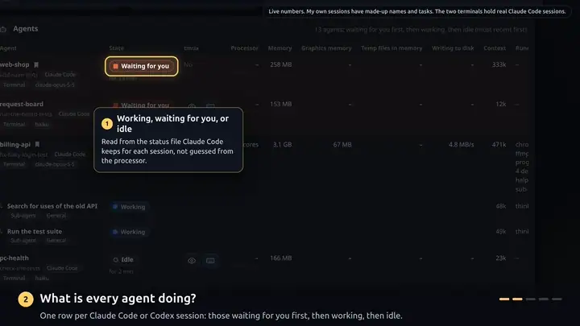

# PC Health

PC Health is a local web dashboard for a Linux workstation that runs several AI coding agents at once
(Claude Code and Codex): it shows whether the machine is healthy, and what each agent is doing and using.
It is for people who leave agents working in tmux and want one page, on the PC or on a phone, that says who
is working, who is waiting for them, and what was left running.

[](docs/demo.mp4?raw=true)

A tour of the dashboard, the agent view, the terminals and the phone layout. The picture is a short preview: click
it for the full video with captions (MP4, 9 MB; GitHub hands it over as a download). The numbers are
live. My own sessions appear under made-up names. The two terminals are real Claude Code sessions, started for the
recording in copies of this repository and of another public one.

## What it shows

- **A health banner.** "Everything looks healthy", or what needs attention. Each problem is its own row: how
  serious, where, for how long, the reason in plain words, and the command to fix it when there is one.
- **Processor, memory, swap, graphics card.** Current use, a trend line (1 hour, 24 hours, 7 days) and what
  it means.
- **Disks.** Free space, how it changed, and "full in about X" when a drive is filling up.
- **Agents.** Every Claude Code and Codex session: working, waiting for you, or idle, with the ones waiting
  for you first. For each: processor, memory, graphics memory, temp files, disk writing, tokens in its
  context, and what it is running. Under a Claude Code agent, the sub-agents it is running right now.
- **Terminals.** Every tmux session, one row each. View it without being able to type, or open it and type,
  in the browser. Start, rename or close one. The open ones are saved and can be brought back after a restart
  of the PC, each with its Claude Code conversation.
- **Left behind by agents.** Headless browsers, dev servers and other helpers an agent started and never
  closed, with the command to stop them.
- **Busiest programs, temperatures and fans, biggest folders.** Where processor time, memory and disk space
  are going.
- **What happened.** Problems and crashes from the last 48 hours, including while you were away.
- **A phone layout** with a bar at the bottom to jump between the sections, and a badge when an agent is
  waiting for you.

The page has two looks, chosen with the settings button in the header and remembered on that device only.
**Simple** (the default) is flat and still: solid panels, no shadows, blur or animation. **Glass** adds a
backdrop of soft light, frosted panels and glass bars, and costs a browser more to draw. The page follows
the device's light or dark setting.

## Requirements

Nothing has to be installed with pip: PC Health uses only Python's standard library, and the page loads
nothing from the internet.

| Needed | What for | Without it |
|---|---|---|
| Linux | Everything is read from `/proc` and `/sys` | It does not run |
| Python 3.11 or newer at `/usr/bin/python3` | Everything | With 3.10 it stops as soon as there is a settings file (`tomllib` came with 3.11). The service and the terminal script call `/usr/bin/python3` by that path, so a newer Python somewhere else does not help them |
| systemd user services (`systemctl --user`) | `./install.sh`: start at login, restart on failure | Run it in the foreground: `python3 -m pchealth serve` |
| Claude Code or Codex | The Agents and Left behind sections | Those sections stay empty; the health part works by itself |
| `nvidia-smi` at `/usr/bin/nvidia-smi` | The graphics card tile, graphics memory per agent, its temperature | The tile says "No reading from the graphics card" and the foot of the page says "gpu (no NVIDIA GPU found)" |
| `tmux` at `/usr/bin/tmux` | The Terminals section, the view-only page, saved terminals | The Terminals section stays empty. 21 of the tests are skipped |
| `ttyd` 1.7.4 or newer at `/usr/bin/ttyd` | Typing in a terminal from the page, and starting, renaming, closing, saving and restoring terminals | View only still works: it does not use ttyd |
| `journalctl` at `/usr/bin/journalctl` | The name of a program Linux stopped when memory ran out, and graphics out-of-memory errors | The foot of the page says "klog (cannot read the system journal)" |

Temperatures come from `/sys/class/hwmon`, memory and processor pressure from `/proc/pressure`. What a
machine does not have is left out of the page.

### Which copy of a program is used

The paths in the table are what the monitor and the unit files run, and a copy somewhere else is not used
by them. The install scripts and `terminal/attach.sh` work differently: they call `python3`, `ttyd` and
`tmux` by name and get whichever comes first on `PATH`. Where everything comes from the distribution's
packages, both find the same programs. Where they do not, a check can pass on one copy while the service
runs another:

- **ttyd on `PATH` but not at `/usr/bin/ttyd`:** `./install-terminal.sh` tests the one on `PATH`, so its
  check passes and it installs the units. The terminal service then cannot start, because its unit runs
  `/usr/bin/ttyd`.
- **Another `python3` first on `PATH`** (conda, pyenv): `install.sh` and the tests run that one, and the
  service runs `/usr/bin/python3`. Tests that pass on the first say nothing about the second.
- **tmux on `PATH` but not at `/usr/bin/tmux`:** the monitor counts tmux as missing.

Check before installing, and go by the second line where the two differ:

```bash
command -v python3 tmux ttyd                           # what the install scripts and attach.sh find
ls -l /usr/bin/python3 /usr/bin/tmux /usr/bin/ttyd     # what the monitor and the services run
/usr/bin/python3 --version                             # must be 3.11 or newer
```

[docs/ARCHITECTURE.md](docs/ARCHITECTURE.md#where-programs-are-looked-for) lists which file calls which
program, and what follows in each case.

### What works on your machine

Run this in the cloned folder, before installing anything:

```bash
python3 -m pchealth selfcheck
```

It prints one line per data source. Its exit code is 1 when any line says something other than `ok` or
`none running`. That happens on a healthy machine too: without an NVIDIA card the `gpu` line says
`no NVIDIA GPU found`, without a readable journal the `klog` line says `cannot read the system journal`,
and without a `~/.claude/sessions` folder the `agents` line says `no Claude Code session folder`. Exit
code 1 says that one of the sources is missing. It does not say that anything is broken or that an install
failed. Read the lines.

## Install, run, uninstall

```bash
git clone https://github.com/lelelilo-studios/pc-health.git
cd pc-health
```

**Decide first who may see the page.** A fresh install has `listen = "lan"`: the page answers this PC, and
every device with a private address on a network this PC is attached to, without a password.
[Security](#security) says what that covers. To keep the page to this PC, the settings file needs one line,
`listen = "local"`. Where there is no settings file yet, this writes it:

```bash
mkdir -p ~/.config/pc-health && echo 'listen = "local"' > ~/.config/pc-health/config.toml
```

If you already have a settings file, change its `listen` line by hand: the command above replaces the file.

**Install it as a service** that starts when you log in:

```bash
./install.sh
```

This writes a per-user unit (`~/.config/systemd/user/pc-health.service`) that runs this folder, and a
"PC Health" entry in the applications menu. It needs no `sudo`. Open **http://localhost:7780**.

```bash
systemctl --user status pc-health     # is it running?
systemctl --user restart pc-health    # after changing settings, or after pulling a new version
journalctl --user -u pc-health        # its log: systemd's start and stop lines; the program itself prints nothing
```

The service runs while you are logged in. To keep it running when you are logged out:
`loginctl enable-linger $USER`. The unit points at the folder you cloned into, so if you move that folder,
run `./install.sh` again.

**Or just run it**, without installing anything:

```bash
python3 -m pchealth serve       # in the foreground; Ctrl+C stops it
```

**Other commands:**

```bash
python3 -m pchealth --once      # print one snapshot as JSON
python3 -m pchealth selfcheck   # which data sources work on this machine
python3 -m pchealth bench       # cost of each part of a sample
python3 -m pchealth url         # addresses of the page
python3 -m pchealth --help      # this list
```

**Uninstall:**

```bash
./uninstall.sh
```

It stops the service and removes the units and the menu entry. Your settings (`~/.config/pc-health/`) and
history (`~/.local/state/pc-health/`) are left in place; delete those two folders and the clone to remove
everything.

**Settings** are optional. They live in `~/.config/pc-health/config.toml`, and `config.example.toml` is a
copy to start from (it shows the defaults). [docs/SETTINGS.md](docs/SETTINGS.md) lists every key, and what
happens to a value the program does not understand.

**From a phone** or a laptop on the same network, the page is at `http://<pc-name>.local:7780` or the
numeric address; `python3 -m pchealth url` prints both. This needs `listen = "lan"`. Below 640 pixels wide
the page switches to a phone layout. [docs/SETTINGS.md](docs/SETTINGS.md#on-a-phone) has the details, and
what to check when a phone cannot open the page.

Typing in terminals from the page is a separate, optional step: see [Terminals](#terminals).

## Set it up with your coding agent

Paste this into Claude Code or Codex on the machine you want to watch:

```text
Please set up PC Health on this machine for me.

1. Clone https://github.com/lelelilo-studios/pc-health into ~/pc-health (use it if it is already there).
   That clone is the only change you may make before I say OK. Until then, only read.
2. Read README.md and docs/AGENT_SETUP.md in it, and follow AGENT_SETUP.md.
3. Check what this machine has: the Linux distribution, the Python at /usr/bin/python3, nvidia-smi, tmux,
   ttyd, systemd user services, and whether port 7780 is free.
4. Tell me what will work here and what will not, ask me which folders hold my projects, and wait for
   my OK.
5. Write ~/.config/pc-health/config.toml for this machine: listen = "local", those folders, and warning
   thresholds that fit my disks and memory.
6. Install it as a user service. The page must answer on this PC only: that is listen = "local" in the
   settings file. Check it with ss -ltn, which must show 127.0.0.1 and the port, not 0.0.0.0.
7. Run the tests, open the page, and report: what works, what does not, and every file you created.

Do not run sudo, install any package, or switch on viewing or typing in terminals without asking me first.
```

[docs/AGENT_SETUP.md](docs/AGENT_SETUP.md) has the details the prompt points to: what to check, what to
adapt, what must not be changed, how to verify that it works, and how to undo it.

## Status and limits

This is a personal tool, version 0.1.0, shared as it is.

- **One machine so far.** It has run on Ubuntu 26.04 with an NVIDIA card, tmux 3.6 and ttyd 1.7.7. Nobody
  has tried another distribution yet.
- **Codex is the weak part.** The Codex side was built from the files Codex leaves on disk, not against a
  running Codex session, and it is known to be incomplete. Every process named `codex` that is not a
  known side command is taken for a session, so a helper that Codex starts under its own name shows as a
  row of its own. "Waiting for you" is not detected: a Codex that has been quiet for 90 seconds in the
  middle of a turn shows as "Possibly waiting for you". Sub-agents, the earlier conversation and restoring
  a conversation after a restart are Claude Code only; a saved Codex terminal comes back as an empty
  terminal.
- **It depends on files that are internal to Claude Code and Codex** (session files, transcripts, rollout
  files). They can change with any release. The readers are tolerant: what is not recognised shows as
  unknown or is left out.
- **No user accounts, IPv4 only, plain HTTP.** Whatever connects from the PC itself is treated as its
  owner, and that includes every other user account on the machine. See [Security](#security).
- **Program paths are fixed in some places and not in others.** The monitor and the unit files run
  `python3`, `tmux`, `nvidia-smi`, `ttyd` and `journalctl` from `/usr/bin`. The install scripts and the
  terminal script find `python3`, `ttyd` and `tmux` through `PATH`. Where the two differ, an install can
  pass its own check and then not start. See [Requirements](#which-copy-of-a-program-is-used).
- **Graphics card:** NVIDIA only, and only the first card.
- **Temperatures:** AMD (`k10temp`, `zenpower`) and Intel (`coretemp`) processors, NVMe drives, and
  sensors labelled as coolant or liquid. Other sensors are not shown.
- **Drives:** ext4, ext3, xfs, btrfs, f2fs, NTFS and exFAT on a `/dev` device. ZFS and network drives are
  not listed.
- **Crash dumps** are looked for where Ubuntu's apport puts them (`/var/lib/apport/coredump`,
  `/var/crash`).
- **Three habits of the author's machine are still in the code:** sub-folders of `/data/scratch` are sized
  if that folder exists; a folder under `/data/` is labelled "not on the main disk"; and the Agents table
  calls an agent's scratch folder under `/tmp` "Temp files in memory" whether or not `/tmp` is a RAM disk
  on your machine.
- **No package.** It runs from the folder you cloned.

## Terminals

The **Terminals** section lists every tmux session, one row each, with what the agent in it is doing. From
a row you can:

- **View** it (`/watch`): a copy of the session's screen, read again every second, without joining the
  session or resizing it. Nothing you press is sent. This needs tmux and nothing else.
- **Open** it (`/terminal`): the session itself in the browser. It is the same session your local terminal
  shows, and you can type in it. This needs the terminal service, below.
- **Start, rename or close** a session, and **bring back** the saved ones after a restart of the PC, each
  with its Claude Code conversation. These go through the terminal service too. Which terminals are open
  is saved by the monitor itself, without anything to press.

This works for sessions **started inside tmux** (`tmux new -s name`, then `claude`). An agent started in a
plain terminal window cannot be opened this way; use the agent's own remote access for those (Claude Code
has one: `claude --remote-control`).

### Switching typing on

Typing needs a small extra program, [ttyd](https://github.com/tsl0922/ttyd), set up once. On Ubuntu:

```bash
sudo apt install ttyd
./install-terminal.sh
```

`install-terminal.sh` needs no `sudo`. It writes two more per-user units: `pc-health-terminal.service`
(ttyd) and `pc-health-restore.service` (idle until you switch it on in Settings). ttyd listens on a socket
file in your login session's runtime folder, not on the network: the only way to it is through PC Health,
under `/tty`. Check that it came up with `systemctl --user is-active pc-health-terminal`;
[Requirements](#which-copy-of-a-program-is-used) describes the case where it does not. To switch typing
off again: `systemctl --user disable --now pc-health-terminal`, or `terminal_type = "off"`.

Optional, and nothing PC Health needs: Ubuntu's ttyd package also sets up a system service of its own,
`ttyd.service`. On Ubuntu 26.04 it puts a login prompt on port 7681 of the PC's loopback address (its
options are in `/etc/default/ttyd`). PC Health does not use it. `systemctl is-enabled ttyd` says whether it
is on. If you do not want it, `sudo systemctl disable --now ttyd` switches it off.

### Who may view and who may type

Two settings, one for each:

| Setting | Guards | Default |
|---|---|---|
| `terminal_view` | The view-only screen of a session, and its earlier conversation | `"local"` |
| `terminal_type` | Typing in a session, and starting, renaming, closing, saving and restoring | `"local"` |

Each takes one of three values:

| Value | This PC | Another device that the page answers |
|---|---|---|
| `"local"` | Allowed | Refused |
| `"lan"` | Allowed | Allowed. If an `access_code` is set it must be entered first; if none is set they get straight in |
| `"off"` | Refused | Refused |

So with the defaults a phone sees the dashboard but no terminals. Two things to know before you rely on
this table, both under [Security](#security): "this PC" is anything that connects from the machine itself,
other user accounts included, and "view" shows the screen as it is, secrets on it included.
**With `terminal_type = "lan"` and no `access_code`, any device on the network can run commands as you.**

### Limits

- At most 8 terminals can be open for typing at once: the terminal service runs ttyd with `-m 8`. View only
  does not use ttyd and is not counted.
- The list of saved terminals holds at most 32.

[docs/TERMINALS.md](docs/TERMINALS.md) has the rest: what a row and its summary show, the earlier
conversation on the view-only page, the bar of terminals, the extra keys on a touch screen, renaming and
closing, how the terminal service is wired, and how terminals are saved and brought back.

## Security

PC Health has no user accounts. It is built for one person, on a machine and a network that person
trusts. What follows is what the code enforces (`pchealth/httpd.py`); `tests/test_server_safety.py`
checks it.

### What "this PC" means

"This PC", here and in the settings, means that a connection comes from a loopback address (127.x.x.x).
The server looks at nothing else, so it cannot tell who on the machine is asking. "This PC" is therefore:

- every user account on the machine, and every program any of them runs;
- a container that shares the host's network;
- whatever reaches the port through an SSH tunnel, or through a proxy running on the machine.

All of these are answered as the owner and are never asked for the access code. With the default settings
they see the dashboard and can view the screen of every tmux session the page lists. Once the terminal
service is installed they can also type in those sessions, which is running commands as you. The terminal
service's own socket is private to your user, but PC Health's port passes a loopback connection on to it.

On a machine that other people can log in to, set `terminal_view = "off"` and `terminal_type = "off"`, and
do not run `./install-terminal.sh`. `"off"` is the only value that refuses this PC as well. The dashboard
itself stays readable to them: no setting closes it to a loopback connection.

### It only reads

PC Health itself never stops, deletes or changes anything. Where something should be stopped or deleted,
the page shows the command and a Copy button; you run it yourself in a terminal. Its server answers only
`GET` requests, and the only tmux commands it runs are ones that read. The only files it writes are its
own, in `~/.local/state/pc-health/`.

The one way to act on the PC from the page is the Terminals section: typing into your own tmux sessions,
and starting, renaming or closing them, saving which are open and bringing those back. All of that goes
to a separate program, the terminal service (ttyd running `terminal/attach.sh`), and PC Health only
carries the connection to it. Restoring takes nothing from the page: it starts what the saved file lists,
checks every field of it first, never types into a session it did not just create, and the only thing it
ever types is the fixed line `claude --resume <conversation id>` (with `--model` if the conversation was
started with one). Without `./install-terminal.sh` there is no terminal service, and the page cannot act
at all.

### Who is answered

- It listens on one TCP port (7780 unless you change it), IPv4, plain HTTP.
- `listen = "local"` binds to `127.0.0.1`: only this PC can connect.
- `listen = "lan"` binds to all interfaces and then answers only two kinds of client: this PC, and a
  private address (10.x, 172.16 to 172.31, 192.168.x, 169.254.x) on a network this PC is directly attached
  to. Any other connection is closed without an answer.
- **`"lan"` is what a fresh install has.** It is also what you get with a settings file that has no
  `listen` line, with a `listen` value of the wrong kind (`listen = 1`), and with a file that cannot be
  read as TOML: such a file is ignored whole, and `listen = local` without the quotes makes one. Only a
  word in quotes other than `"lan"` gives `"local"`. [Install](#install-run-uninstall) has the one line
  that sets it. After setting it, restart the service and check with `ss -ltn | grep 7780`: it must show
  `127.0.0.1:7780`, not `0.0.0.0:7780`.
- "A network this PC is directly attached to" is your home Wi-Fi, but it is also an office or café
  network, and any VPN or container network with private addresses. On a laptop that travels, use
  `listen = "local"`.
- Every device that is answered sees the whole dashboard without a password: the host name, project and
  session names, folders, program names. To change that, set an `access_code` and `protect = "page"`.

To reach a PC that listens only locally from another machine, use an SSH tunnel with the same port number
on both ends (the page refuses requests addressed to another port):
`ssh -L 7780:127.0.0.1:7780 you@the-pc`, then open `http://localhost:7780`. Through the tunnel you count as
the PC itself.

### What a request must look like

- `GET` only. Anything else gets `405`.
- The `Host` header must name this PC: `localhost`, `127.0.0.1`, its host name, its host name with
  `.local`, or the address the connection arrived on, with the right port. An `Origin` header, if there
  is one, must name the same. A request the browser marks as coming from another site is refused. This is
  what stops a website you visit from reading the page through your browser.
- Addresses are matched against a fixed table. Nothing a visitor sends is used as a file path.
- The page is sent with `Content-Security-Policy: default-src 'self'` and may not be framed.

### Who may use terminals

The two switches and their values are in the table under
[Terminals](#who-may-view-and-who-may-type). With the defaults, only this PC can look into a terminal or
type in one, and "this PC" is everything listed [above](#what-this-pc-means).

The page names a session and nothing else: which pane or which file is read is decided by PC Health,
never by the request. The terminal service is not on the network: PC Health passes `/tty` on to its socket
file and hands over ten named request headers and no others (cookies are not among them).

### The access code

`access_code` is for other devices. They enter it once, on a small login page. It guards terminals, or
everything with `protect = "page"`. This PC is never asked. What it does and does not do:

- **Use letters and digits only** (a to z, A to Z, 0 to 9), and write the code in quotes. The login page
  sends the code in the address, and the server compares the raw text of that address with the code,
  without decoding it. A browser encodes most other characters on the way (a space becomes `+`, `&`
  becomes `%26`), so a code with `&`, `%`, `+`, `#`, a space or an accented letter in it never matches, and
  nobody can log in. (`-`, `.` and `_` are sent unchanged and do work.) A code written without quotes,
  like `access_code = 4821`, is a number where a word belongs: it is ignored, and there is no code at all.
- **It does not limit guessing.** A wrong guess makes that one connection wait a second (a
  `time.sleep(1.0)` in the thread that serves it). Other connections are not slowed, and the server takes
  up to 64 at once. Nothing counts wrong guesses or locks a device out. Choose a long code.
- **The cookie is no safer than the code.** After the right code the browser gets a cookie: one fixed
  value derived from the code, the same for every device, valid for a year. It is sent without the `Secure`
  flag, over plain HTTP, with every request. Anyone who can read the traffic can copy it and use it, just
  as they can read the code in the address of the login request. Deriving it only keeps the code itself
  out of the browser's cookie store. The server cannot end one login: the value stays good until the code
  is changed and the service restarted, and that ends all of them.
- **Some addresses answer without the code, even with `protect = "page"`:** `/healthz` (the word `ok`, the
  number of samples taken and the age of the last one), `/api/me` (whether the asker is this PC, and a
  status number each for viewing and typing, which shows whether that switch is off, local, or waiting for
  the code), `/app.css` (the login page needs its stylesheet), and the login page itself at `/` and
  `/login`. The terminal addresses (`/api/terminal`, `/api/conversation`, `/tty`) are refused under their
  own rule, and the refusal also shows which of those three states the switch is in. Everything else
  answers `401`, or `404` for a terminal page whose switch is `"off"`.
- **`protect = "page"` does nothing without an `access_code`:** with no code set, nobody is asked for one.

### What reaches the page, and what never does

The dashboard, which every answered device gets, never carries:

- A process's command line or its environment. Agent processes carry secret tokens in their environment;
  only a fixed list of eight harmless variables is ever read from it. Command lines are read for three
  things: to recognise what a program is (a headless browser, a dev server), an agent's `--model`, and how
  Codex was started. Only what was recognised is kept, never the command line.
- The id that would resume a conversation. (The view-only page is given its first eight characters, to
  notice when another conversation has begun in that terminal.)
- Anything a sub-agent read, wrote or ran.

Viewing a terminal is different, and nothing is filtered there:

- **The screen** (`/api/terminal`) is the text tmux has on that session's screen right now, as it is.
  Whatever is printed or pasted there reaches whoever may view: the output of `env` or of `cat .env`, a
  token pasted into a prompt, tool output the agent's interface shows.
- **The earlier conversation** (`/api/conversation`) carries what was typed, the agent's answers, and one
  line per action: the tool's name and what it was pointed at, which can be the start of a command or a
  file path. Tool output, attachments, images and the model's private reasoning are not read out. That
  holds for this address only, not for the screen.

### Plain HTTP

There is no encryption. On a shared network, what the page shows, what you type in a terminal and the
access code can be read by another device on it. Keep it to a network you trust, or to this PC.

## How it works

Two threads. A sampler reads `/proc` and builds one snapshot per tick: every 2 seconds while a page is
open, every 10 seconds when nobody is looking. A worker does everything that can block: `nvidia-smi`, the
journal, drive and folder sizes, the agents' own files. The snapshot is turned into JSON once, and the web
server hands out those same bytes to every page. Agents are processes named `claude` or `codex`, joined
with the session files those programs keep. The monitor watches its own cost: it slows down above 5% of
one processor thread and stops itself above 25%.

[docs/ARCHITECTURE.md](docs/ARCHITECTURE.md) has the rest: how agents, sub-agents and leftovers are found,
how it stays light and what it was measured to cost, the layout of the code, and what each test file
covers.

## Tests

```bash
python3 -m unittest discover -s tests
```

164 tests, about 5 seconds, no dependencies. They pass on Python 3.11, 3.12 and 3.14. They cover the
readers of `/proc`, `/sys` and other programs' output, the logic, what the server refuses, that the code
has no call that stops, deletes or changes anything, and that a secret planted in a process's environment
and command line never reaches a snapshot. 21 of them drive `terminal/attach.sh` against a tmux server and
a home folder of their own, in a temporary folder, so your sessions and saved terminals are never touched;
they are skipped where `/usr/bin/tmux` is missing.
[docs/ARCHITECTURE.md](docs/ARCHITECTURE.md#tests) says what each file covers.

## Licence

MIT. See [LICENSE](LICENSE).
